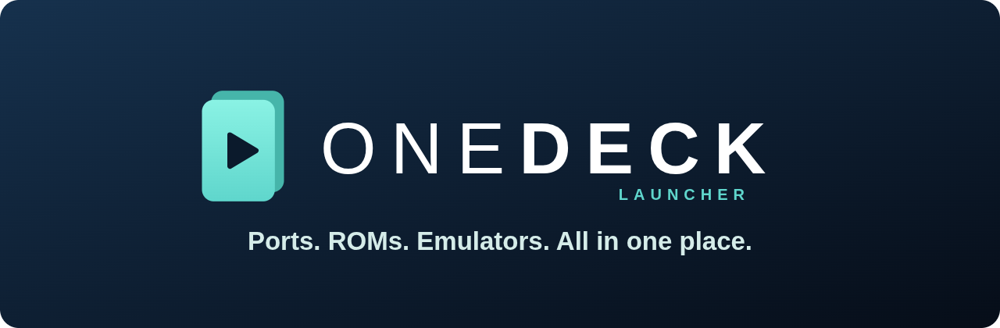
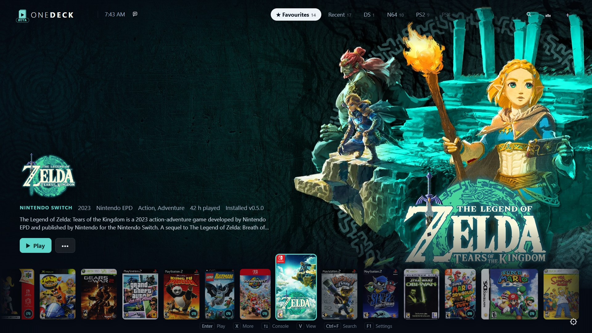

# Emulators and PC ports, all on OneDeck.

## What makes it different

- **Every console, one deck:** OneDeck sorts your games by console, with box art, logos and video previews fetched for you.
- **Emulators, set up for you:** OneDeck installs the right emulator for your game and auto-applies settings for your screen. 20 emulators, from NES to Switch 2.
- **PC ports in one click:** OneDeck searches [Recompendium](https://recompendium.com/) for native PC ports of your games, with their playability score. Want to add your own? Paste its GitHub link.
- **Always up to date:** update your ports and emulators in one click.
- **Cloud saves:** link your devices with a code, or use a cloud storage service.

## Badges

| | |
|---|---|
|  | Emulator up to date |
|  | Emulator has an update |
|  | No emulator yet |
|  | PC port has an update |

## Get it

Windows 10 and 11. Download the zip from [Releases](https://github.com/onedeck-launcher/onedeck/releases), unzip, run
`OneDeck.exe`. If Windows warns you: **More info → Run anyway**.

Linux: coming soon.

OneDeck doesn't include any games or system files: bring your own. Not affiliated with any console maker.

## Built on

[PyroCade](https://github.com/Pyrodrifter/PyroCade) · [Recompendium](https://recompendium.com/) ·
[OpenSave](https://github.com/Liquid-co/OpenSave) · [LaunchBox Games Database](https://gamesdb.launchbox-app.com/) ·
[GameTDB](https://www.gametdb.com/) · [libretro thumbnails](https://thumbnails.libretro.com/) ·
[Electron](https://www.electronjs.org/) · [yt-dlp](https://github.com/yt-dlp/yt-dlp) · [FFmpeg](https://ffmpeg.org/)

## License

[MIT-0](LICENSE): do what you like. The parts based on PyroCade keep its MIT notice ([notices](THIRD_PARTY_NOTICES.md)).
